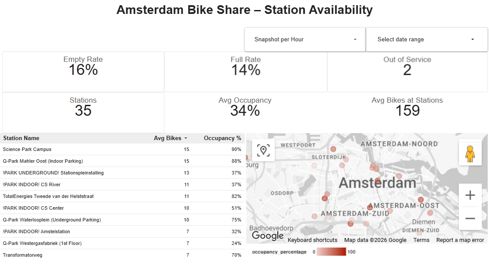
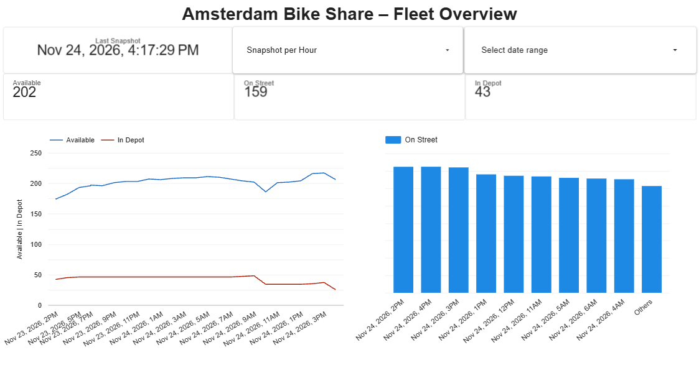
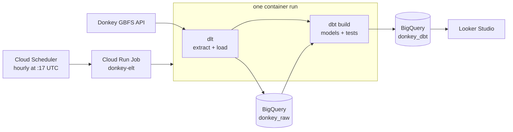

# Amsterdam Bike Share ELT

An hourly ELT pipeline that captures the public [GBFS](https://gbfs.org/) feed of
Donkey Republic's Amsterdam bike share, loads it into BigQuery and models it
with dbt for a Looker Studio dashboard.

GBFS only publishes the *current* state of stations and vehicles. History
exists only if someone stores a snapshot at every run, so this pipeline does
exactly that.

**Dashboard:** [Looker Studio report](https://lookerstudio.google.com/reporting/43279d71-9c44-49ec-a209-692398859cbb)

**dbt docs:** [models, column descriptions and lineage graph](https://ozcan-ozgur.github.io/amsterdam-bikeshare-elt/)

| Station Availability | Fleet Overview |
|---|---|
|  |  |

## Architecture



1. **Cloud Scheduler** triggers the **Cloud Run Job** every hour.
2. The job runs one Docker image: `python donkey_pipeline.py && dbt build --exclude-resource-type unit_test`.
   If loading fails, dbt does not run. A failed run exits non-zero and Cloud
   Run retries it once.
3. **dlt** reads five GBFS endpoints and appends them to the `donkey_raw`
   dataset. Each row gets a `fetched_at` timestamp.
4. **dbt** builds staging views and incremental mart tables in `donkey_dbt` and
   runs all data tests. Unit tests test code, not data, so they run in CI only.
   Column descriptions are written to BigQuery (`persist_docs`).
5. **Looker Studio** reads the two incremental mart tables.

## Data model

| Layer | Model | Grain |
|---|---|---|
| staging (views) | `stg__station_status`, `stg__vehicle_status`, `stg__station_information`, `stg__vehicle_types`, `stg__system_pricing_plans`, `stg__system_pricing_plans__per_min_pricing` | one row per source record; snapshots get a `snapshot_at` per dlt load |
| marts (incremental tables) | `fct__station_availability` | one row per station per snapshot: vehicles, free docks, capacity, occupancy %, coordinates |
| marts (incremental tables) | `fct__fleet_snapshot` | one row per snapshot: total, available and depot vehicles for the whole fleet |

`station_status` and `vehicle_status` are appended on every run, which builds
the history. Reference endpoints (`station_information`, `vehicle_types`,
`system_pricing_plans`) are replaced on every run.

### Incremental marts

- Each run processes only snapshots newer than the latest `snapshot_at` in the
  mart. The grain is the `unique_key`, so re-processing a snapshot never creates
  duplicates (`merge` on BigQuery, `delete+insert` on DuckDB).
- Station attributes (name, capacity, coordinates, `is_listed_station`) are
  frozen as of snapshot time. `station_information` is replaced on every load,
  so the marts are the only place that keeps this history.
- On BigQuery only, both marts are partitioned by day on `snapshot_at`, and
  `fct__station_availability` is also clustered by `station_id`.
- `dbt build --full-refresh` rebuilds the marts from the raw tables, but it
  overwrites historical station attributes with the current ones.

Data quality is checked with dbt data tests (`not_null`, `unique`, and
`dbt_utils.unique_combination_of_columns` / `accepted_range`) on staging and
mart models. Unit tests cover the incremental filter and the NULL handling of
vehicle flags.

### Things the data taught me

- **Unlisted stations:** some vehicles sit at station IDs that are missing
  from `station_information`. They are depots or non-public locations.
  `fct__fleet_snapshot.vehicles_at_unlisted_stations` counts them.
- **Occupancy can exceed 100%:** vehicles can be parked above a station's
  capacity. A `warn`-severity test monitors this instead of failing the run.
- **Disabled and reserved vehicles are always 0:** the feed does not seem to
  publish them. A unit test covers the NULL and true cases the feed has not
  produced yet.
- **All timestamps are UTC.**

## Run it locally

Requires [uv](https://docs.astral.sh/uv/) and Python 3.14. Local runs use
DuckDB, so no cloud account is needed.

```bash
uv sync

# Extract + load into ./donkey.duckdb
uv run python donkey_pipeline.py

# Transform + test
cd donkey_dbt
uv run dbt deps
uv run dbt build --exclude-resource-type unit_test

# Unit tests (after the build: the incremental unit test reads the
# column types of the existing mart table)
uv run dbt test --select test_type:unit
```

Or run the same container that runs in production (against DuckDB inside the
container):

```bash
docker build -t donkey-elt .
docker run --rm donkey-elt
```

## CI

`.github/workflows/ci.yml` runs on pushes to `main` and on pull requests: `ruff` lint,
a real load from the GBFS API into a fresh DuckDB, `dbt build` with all data
tests, and then the dbt unit tests.

## Repository layout

```
├── donkey_pipeline.py      # dlt source: GBFS REST endpoints -> raw tables
├── .dlt/config.toml        # dlt config (BigQuery location)
├── donkey_dbt/             # dbt project (staging views, mart tables, tests)
│   └── profiles.yml        # dev = DuckDB, prod = BigQuery
├── Dockerfile              # image for the Cloud Run Job
└── .github/workflows/      # CI
```

## Tools

| Tool | Used for |
|---|---|
| [dlt](https://dlthub.com/) | REST API extraction and loading (`rest_api_source`) |
| [dbt](https://www.getdbt.com/) (`dbt-bigquery`, `dbt-duckdb`) | transformations and data tests |
| [dbt-utils](https://hub.getdbt.com/dbt-labs/dbt_utils/latest/) | `unique_combination_of_columns`, `accepted_range`, `safe_divide` |
| [dbt-codegen](https://hub.getdbt.com/dbt-labs/codegen/latest/) | generating staging model and unit test skeletons |
| [SQLFluff](https://sqlfluff.com/) + `sqlfluff-templater-dbt` | SQL linting (dbt templater, DuckDB dialect) |
| [DuckDB](https://duckdb.org/) | local development warehouse |
| [BigQuery](https://cloud.google.com/bigquery) | production warehouse |
| [Docker](https://www.docker.com/) + Artifact Registry | the ELT image |
| [Cloud Run Jobs](https://cloud.google.com/run/docs/create-jobs) | running the ELT |
| [Cloud Scheduler](https://cloud.google.com/scheduler) | hourly trigger |
| [GitHub Actions](https://github.com/features/actions) | CI |
| [Looker Studio](https://lookerstudio.google.com/) | dashboard |
| [dbdiagram.io](https://dbdiagram.io/) | ER diagram of the dlt schema (`dlt pipeline donkey schema --format dbml`) |
| [uv](https://docs.astral.sh/uv/), [ruff](https://docs.astral.sh/ruff/) | dependency management, linting |


## Data source

Data: [Donkey Republic](https://www.donkey.bike/) public GBFS feed
(`https://stables.donkey.bike/api/public/gbfs/3.0/donkey_am/`).
